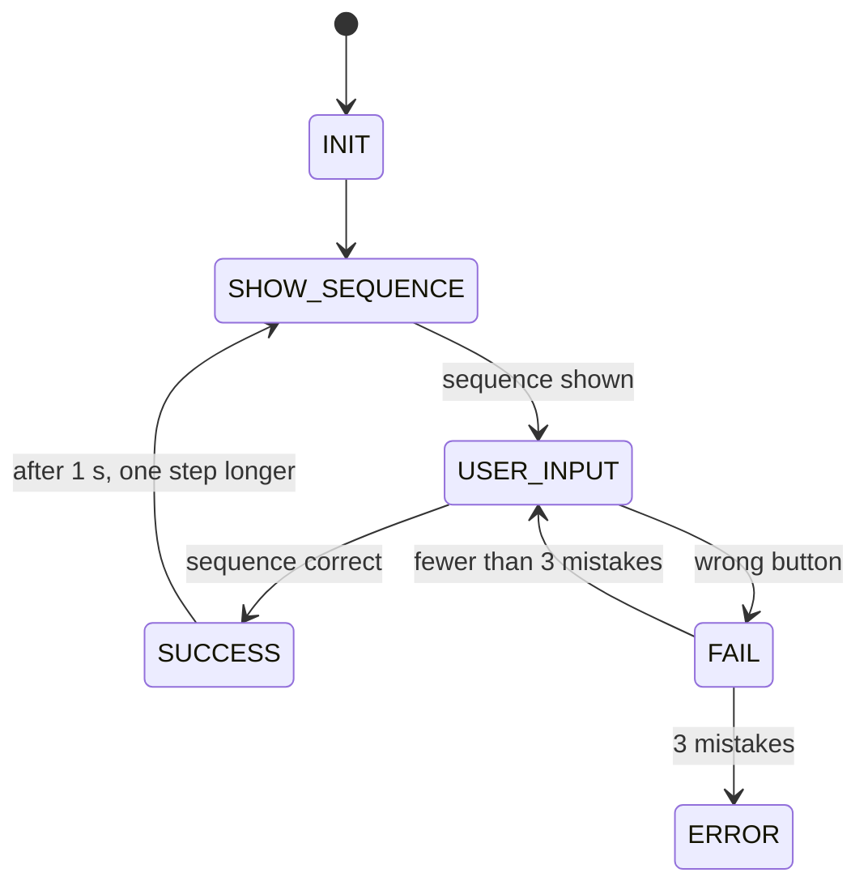

# Arduino Memory Game

A Simon-style memory game for Arduino Uno: watch the LED sequence, repeat it on the buttons, and it grows by one step each round. Exam project for the *Real-Time Systems* course at Singidunum University.

The game runs as a non-blocking state machine with no `delay()` calls, driven by a hardware timer and button interrupts.

## How to play

1. The four main LEDs play a sequence, starting with two steps.
2. When the yellow LED turns on, repeat the sequence on the buttons.
3. If it is correct, the green LED lights for a second and the sequence gets longer.
4. After a mistake the buzzer sounds, the red LED blinks and you enter the sequence again from the start. It blinks faster after the second mistake.
5. The third mistake in a game locks it with the red LED on. Press the board's reset button to play again.

## State machine

## Real-time techniques

| Technique | Use |
|---|---|
| Timer1 in CTC mode (`OCR1A = 249`, prescaler 64) | 1 ms time base and red LED blinking |
| External interrupts INT0 and INT1 | Buttons 1 and 2 |
| Pin change interrupt PCINT2 | Buttons 3 and 4, as the Uno has only two external interrupt pins |
| Timestamp comparison | 200 ms software debounce and non-blocking delays |

## Wiring

| Component | Pin | Connection |
|---|---|---|
| Buttons 1-4 | 2, 3, 4, 5 | To GND (internal pull-ups) |
| Green LED (success) | 6 | Through a resistor to GND |
| Yellow LED (input) | 7 | Through a resistor to GND |
| Red LED (mistake) | 8 | Through a resistor to GND |
| Passive buzzer | 9 | To GND |
| Main LEDs 1-4 | 10, 11, 12, 13 | Through a resistor to GND |

Leave A0 unconnected. It is read to seed the random generator.

## Getting started

### Prerequisites

- Arduino Uno or another ATmega328P board running at 16 MHz
- [Arduino IDE](https://www.arduino.cc/en/software)
- 7 LEDs with resistors (for example 220 Ω), 4 push buttons, a passive buzzer, a breadboard and wires

### Upload

1. Wire the components as shown above.
2. Open `Ispit_SRV/Ispit_SRV.ino` in the Arduino IDE.
3. Select the board and port, then click **Upload**. No external libraries are needed.
4. Optionally open the Serial Monitor at 9600 baud to follow the state changes.

## Known issues

- The sequence is predictable (1, 2, 3, 4, 1, ...), because the `random()` calls are commented out.
- The sequence length is not checked against the 64-element array.
- Button presses during playback are counted once input starts.
- The red LED keeps blinking after a mistake has been corrected.

## Author

[Veljko Milisavljević](https://github.com/veljko-milisavljevic)
